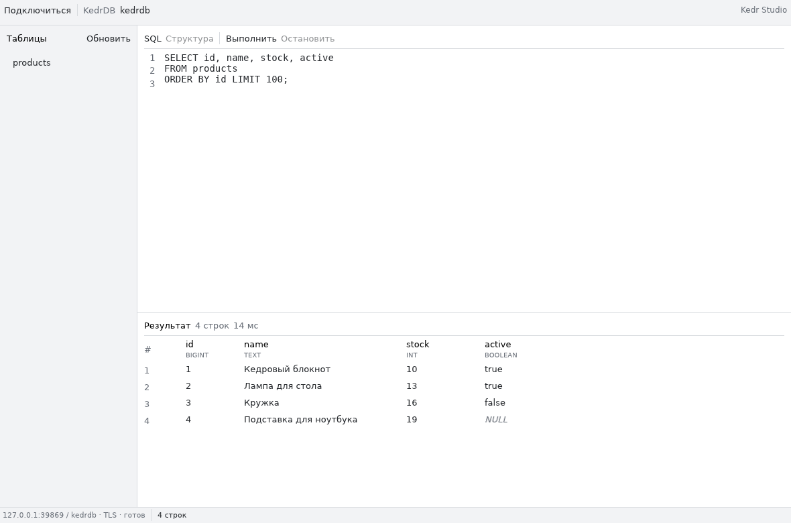

# Kedr Studio: первый интерфейс

Дата: 10 октября 2026 года. Статус: направление дизайна для начальной реализации этапа 6.

## Пересмотр после обратной связи

Пользователь отклонил первый вид: стандартные кнопки, раскрывающийся список и повторяющиеся демонстрационные надписи выглядят шаблонно. Новый вариант строится как компактное рабочее приложение, без большого логотипа в содержимом окна. Системные шрифты: San Francisco/Menlo на macOS, доступный системный sans/mono на Linux; fallback встроенный. Файлы системных шрифтов читаются на машине, не копируются в поставку.

Новая палитра: фон навигации `#F2F3F5`, рабочая область белая, текст `#24272B`, разделитель `#D8DBDF`, акцент действия `#285C93`. Панель соединения компактная. Слева плоский список имен таблиц; структура выбранной таблицы показана отдельно, без кнопок «Запрос-пример» в дереве. Основные действия — «Выполнить», остановка, подключение; объяснения функций находятся в tooltip/ошибках. Результаты — обычная сетка с согласованными ширинами, не набор отдельных кнопок.

Демонстрационная информация не занимает заголовок настоящего рабочего подключения. До интеграции с сервером диагностический режим явно обозначен один раз в нижнем статусе. После подключения статус показывает реальный сервер и состояние транзакции; тестовые данные не подмешиваются.

Проверка плана: сохранена нужная компоновка SQL над результатами, но заменены стандартное оформление, шрифт и способ навигации. Убраны раскрывающиеся уровни, повторные подсказки и оформление «витрины». Следующий визуальный просмотр проводится на настоящем окне, затем на реальных данных после серверной интеграции. Предыдущий план ниже остается историей первого варианта, а не текущим требованием.

Задача пользователя — простая рабочая админка, приблизительно по компоновке pgAdmin. Визуальные конструкторы и расширенные возможности остаются после 1.0. Приоритет: прочитать структуру базы, написать SQL, понять результат или ошибку.

## План

Палитра: рабочий фон `#F5F7F9`, панели `#FFFFFF`, текст `#17272E`, разделители `#D5DDE3`, основной акцент `#246B54`, клавиатурный фокус `#3D6BBD`. Ошибки выделяются цветом и текстом, а не только цветом. Никаких декоративных градиентов и анимаций загрузки страницы.

Типографика: встроенный пропорциональный шрифт egui для навигации и сообщений; моноширинный для SQL, типов и значений. Обычный текст 14–15 pt, SQL 15 pt. Кириллица проверяется на реальном окне. Кнопки называют действие, состояние не маскируется под кнопку.

Компоновка: все выровнено слева; верхняя узкая полоса продукта и подключения, слева изменяемая по ширине область объектов, справа редактор над результатами, снизу состояние операции. Место отдается запросу и данным, а не приветственным блокам.

```text
+------------------------------------------------------------------+
| Kedr Studio                      Подключение / режим              |
+-------------------+----------------------------------------------+
| Объекты           | SQL                        Выполнить Отменить |
|                   |                                              |
| Таблица           | редактор                                     |
|   столбец : тип   |                                              |
|   индекс          +----------------------------------------------+
|                   | Результат / Сообщения                        |
|                   | столбцы, строки, NULL                        |
+-------------------+----------------------------------------------+
| Соединение / транзакция / время / число строк                      |
+------------------------------------------------------------------+
```

Режим предпросмотра явно указан постоянно. Его каталог и строки — примеры; он не подключается к серверу, не читает файлы базы, не имитирует успешную запись. Реальное подключение добавляется после серверной поддержки. На стартовом экране без подключения нет вымышленных пользовательских таблиц.

## Проверка плана перед кодом

Сохраняем привычное расположение pgAdmin согласно прямому запросу. Убираем dashboard, статистические карточки и крупное приветствие: они отвлекают от SQL. Небольшой зеленый акцент связывает продукт с названием «Кедр», но не заменяет смысл цветов статуса. Для первого выпуска одна читаемая тема; оформление дальше развивается по использованию.

Первый реализуемый сценарий: открыть окно → явно включить предпросмотр → раскрыть пример структуры → показать пример результата → скопировать значение. Длинные операции идут в ограниченной фоновой очереди. Запись и произвольный SQL в предпросмотре отклоняются с объяснением. Следующая интеграция должна сохранить эти компоненты интерфейса, заменив адаптер.

## Проверка после сборки

Снимок настоящего native-окна; кириллица, размеры, контраст, разделители и скролл проверяются визуально. Проверяем пустое состояние, пример результата, отмену и ошибку. Это проверка интерфейса, не приемка сетевого сервера и не завершение этапа 6.

## Настоящее подключение после переработки


Снимок настоящего окна после подключения и SELECT, 10 октября 2026. Данные созданы проверочным сценарием в отдельной базе и прочитаны через сервер/драйвер; это не preview adapter. Проверены реальные текст/тип/NULL и нижний статус. Изменение внешнего вида не заменяет отдельные тесты подключения, транзакций, ошибок и отмены.

Linux native acceptance того же кода также пройден; снимок просмотрен:



Сеть/SQL проверены отдельными тестами. Новый вид заменил отклоненный первый вариант; дальнейшая оценка удобства и внешнего вида проводится с пользователем.
